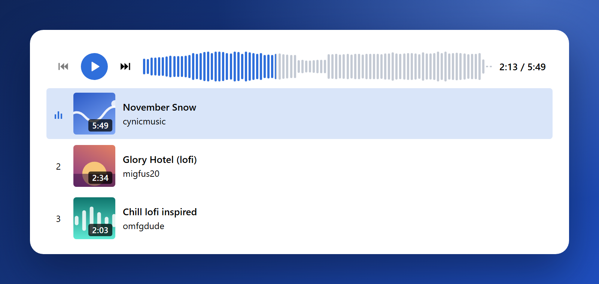

<div align="center">


# SonicFrame.js

Draw sound on the web: waveforms, ready-made players, spectrograms and more, with no dependencies.

[](https://www.npmjs.com/package/sonicframe)
[](LICENSE)
[](package.json)
[](https://www.npmjs.com/package/sonicframe)
[![Support SonicFrame: buy me a coffee][coffee-badge]](https://www.doativa.com/support-sonicframe)

**[Docs](https://ediejohnny.github.io/sonicframe/)** ·
[Quickstart](https://ediejohnny.github.io/sonicframe/quickstart.html) ·
[Theme gallery](https://ediejohnny.github.io/sonicframe/themes.html) ·
[Examples](https://ediejohnny.github.io/sonicframe/guide-podcast.html) ·
[Changelog](CHANGELOG.md)



</div>

## Why SonicFrame

- **Nothing else to install.** One MIT package with no dependencies. Plain pages or any framework: it only asks for
  an element to draw in.
- **Accessible from the start.** Every wave is a keyboard slider that says where it is, and every control is a real
  button.
- **Light with hundreds of players.** Shared observers and one animation loop; only a wave near the screen keeps
  pixels, and only a playing one moves.
- **Strict CSP friendly.** No inline styles, no `eval`, no blob workers, no HTML parsed. Colors come from your CSS.
- **Long sounds.** Zoom, scroll and a minimap, with ready-made peaks files, so an hour of audio opens at once.
- **A whole player in one line.** 24 themes, 8 palettes and 10 drawings, from JavaScript or as an HTML tag. The
  [theme gallery](https://ediejohnny.github.io/sonicframe/themes.html) shows them all, live, with the code for each.

## Install

```sh
npm install sonicframe
```

One package, four entries: `sonicframe` (the wave), `sonicframe/player` (a whole player), `sonicframe/analysis`
(levels, silences, waveform files) and `sonicframe/record` (recording from the microphone).

No package manager? Load it from a CDN, or
[build it from the source code](https://ediejohnny.github.io/sonicframe/installation.html#from-the-source-code) and
copy the files into your site.

## Quick start

In JavaScript:

```js
import { createPlayer } from 'sonicframe/player';

createPlayer({
    container: document.querySelector('#voice'),
    src: '/voice.mp3',
    theme: 'bubble',
});
```

As an HTML tag:

```html
<sonic-player src="/voice.mp3" theme="bubble"></sonic-player>

<script type="module">
    import { defineSonicPlayer } from 'sonicframe/player';
    defineSonicPlayer();
</script>
```

Only the wave, on your own `<audio>`:

```js
import { SonicFrame, loadWaveform } from 'sonicframe';

SonicFrame.create({
    container: document.querySelector('#wave'),
    media: document.querySelector('audio'),
    peaks: () => loadWaveform('/voice.dat'),
    a11y: { label: 'Playback position' },
});
```

The [Quickstart](https://ediejohnny.github.io/sonicframe/quickstart.html) goes through it step by step, and
[Peaks](https://ediejohnny.github.io/sonicframe/peaks.html) shows how to serve the waveform so the page never decodes
the audio.

## Accessibility

Sound is for everyone, so accessibility is where SonicFrame starts, not an add-on.

- **The wave is a slider.** It takes the focus, has `role="slider"`, and says where it is as a time ("1:05 / 3:20").
  The keys are the WAI-ARIA ones: the arrows step, Page Up and Page Down jump further, Home and End go to the ends.
- **Every control is a real button** with a name, and every word comes in English, Portuguese (Brazil or
  Portugal), Spanish or French, or yours: [Languages](https://ediejohnny.github.io/sonicframe/languages.html).
- **One place for it all, the `a11y` group,** by place and action. On the tag, the attributes start with `a11y-`.

    ```js
    createPlayer({
        container,
        src: '/episode.mp3',
        a11y: {
            lang: 'pt',
            description: { keys: true, button: true },
        },
    });
    ```

    ```html
    <sonic-player
        src="/episode.mp3"
        a11y-lang="pt"
        a11y-description="keys button"
    ></sonic-player>
    ```

- **Announcements** go through one shared, polite live region: with `a11y.zoom.announce`, for example, the new view
  after a zoom by the keys.
- **The wave in words.** For people who cannot see the wave, its shape is written out and read by their own screen
  reader: "33 seconds. Sound until 20 seconds, a pause of 4 seconds, then sound to the end. Loudest at 12 seconds."
  With `keys`, D says it again and P moves between the parts; with `button`, a button reads it in the browser's own
  voice. Off until you turn it on.
- **Chapters you can hear.** With chapters, C and Shift+C go to the next and the previous one and say where they
  landed ("Chapter 3 of 8: Interview, 12:30"); the slider's words name the chapter playing, and the list of
  chapters is a `nav` that marks the current one.
- **Captions:** a line of text under the wave (a transcript's first words, a title) whose full text reaches screen
  readers through the wave's description.
- **Motion is opt-in.** Animations are off by default and never run when the person asks for reduced motion.

**How we check it.** Roles, names, values, keys and announcements are covered by the tests and checked by hand in
the browser. The real proof comes from people who use a screen reader every day: if that is you, please
[open an issue](https://github.com/ediejohnny/sonicframe/issues) and tell us what works and what does not.

More in the docs: [Accessibility](https://ediejohnny.github.io/sonicframe/accessibility.html),
[Keyboard](https://ediejohnny.github.io/sonicframe/keyboard.html) and
[The wave in words](https://ediejohnny.github.io/sonicframe/words.html).

## What's inside

| Part                             | What it does                                                                                            | Docs                                                                      |
| -------------------------------- | ------------------------------------------------------------------------------------------------------- | ------------------------------------------------------------------------- |
| The frame (`sonicframe`)         | The waveform: draws it, follows an `<audio>` or `<video>`, seeks by click, drag and keys.               | [The frame](https://ediejohnny.github.io/sonicframe/frame.html)           |
| The player (`sonicframe/player`) | A whole player: play, time, speed, skip, volume, zoom buttons, and the `<sonic-player>` tag.            | [Player basics](https://ediejohnny.github.io/sonicframe/player.html)      |
| Themes and palettes              | A whole look in one word; make your own from any of them, with a background of its own.                 | [Themes](https://ediejohnny.github.io/sonicframe/theming.html)            |
| Plugins                          | Markers, chapters, regions, a timeline, captions, a spectrogram, skipped silences and live frequency.   | [Plugins](https://ediejohnny.github.io/sonicframe/plugins.html)           |
| Long sounds                      | Zoom, scroll, a minimap, and audiowaveform `.dat` and JSON files, read and written.                     | [Zoom and scroll](https://ediejohnny.github.io/sonicframe/zoom.html)      |
| Chapters                         | WebVTT and Podcasting 2.0 JSON chapters: lines on the wave, keys, and a list in the player.             | [Chapters](https://ediejohnny.github.io/sonicframe/chapters.html)         |
| Analysis (`sonicframe/analysis`) | Levels, silences, the wave in words and waveform files, pure, in the browser or in Node.                | [Analysis](https://ediejohnny.github.io/sonicframe/analysis.html)         |
| Recording (`sonicframe/record`)  | Record from the microphone, hear it back and send it: a ready-made screen, a tag, or the bare recorder. | [Recording](https://ediejohnny.github.io/sonicframe/recording.html)       |
| Backgrounds                      | A player's own background: a color, a gradient or an image, with filters, effects and gentle motion.    | [Backgrounds](https://ediejohnny.github.io/sonicframe/backgrounds.html)   |
| Lock screen and media keys       | The system's media controls: title, pictures, play, pause, skip, seek and chapters.                     | [Lock screen](https://ediejohnny.github.io/sonicframe/media-session.html) |
| Languages                        | Every word in English, Portuguese (Brazil or Portugal), Spanish or French, or a language of your own.   | [Languages](https://ediejohnny.github.io/sonicframe/languages.html)       |

Every option, method, event and attribute is in the
[Reference](https://ediejohnny.github.io/sonicframe/frame-options.html).

## Browser support

Current Chrome, Edge, Firefox and Safari. Rounded bars fall back to drawn arcs where `roundRect` is missing, and sizes
fall back to CSS pixels times the screen density where `device-pixel-content-box` is missing.

## Security

- No HTML is ever parsed: text goes in as text, icons are built element by element, and nothing uses `innerHTML` or
  `eval`. Styles are set through the CSSOM, so a strict Content-Security-Policy without `'unsafe-inline'` works.
- Colors only reach properties that take nothing but a color, so a color can never make the page fetch an address.
- Everything that comes from outside has a ceiling: peaks files, text, regions, FFT sizes, clips and downloads.
- No runtime dependencies and no install scripts. The only text in the package that looks like an address is the SVG
  namespace, `http://www.w3.org/2000/svg`, a name the browser needs to create the icons; it is never fetched, and
  the build check fails on any other.

Report a vulnerability privately on GitHub, with
[Report a vulnerability](https://github.com/ediejohnny/sonicframe/security/advisories/new), rather than in a public
issue: [SECURITY.md](SECURITY.md) says how. The details are in
[Security](https://ediejohnny.github.io/sonicframe/security.html).

## Versions

From 1.0.0, SonicFrame follows [Semantic Versioning](https://semver.org/): fixes in patches, new features (each off
until you turn it on) in minor versions, and anything that can break your code only in a major version, listed in
advance. Old names keep working until the next major version. Each version from 1.0.0 is published from this
repository's GitHub workflow, with npm provenance. More in
[Versions and support](https://ediejohnny.github.io/sonicframe/versions.html).

## Report a problem or contribute

- Found a bug, or something hard to use? [Open an issue](https://github.com/ediejohnny/sonicframe/issues) with what
  you did, what you expected and what happened.
- To run it: clone the repository, `npm install`, then `npm run dev` and open `/playground/`, the docs site with
  every example live. `npm test` runs the tests.
- [CONTRIBUTING](CONTRIBUTING.md) says how to send a change, and how to add a language in one file.

## Support SonicFrame

SonicFrame is free, and it stays free. If it saves you time, you can
[buy me a coffee](https://www.doativa.com/support-sonicframe): every donation goes into the work behind new releases,
their tests and the docs.

## License

[MIT](LICENSE) © Edie Johnny

[coffee-badge]: https://img.shields.io/badge/support-buy%20me%20a%20coffee-1f4fbf?logo=data%3Aimage%2Fsvg%2Bxml%3Bbase64%2CPHN2ZyB4bWxucz0iaHR0cDovL3d3dy53My5vcmcvMjAwMC9zdmciIHZpZXdCb3g9IjAgMCAyNCAyNCIgZmlsbD0ibm9uZSIgc3Ryb2tlPSJ3aGl0ZSIgc3Ryb2tlLXdpZHRoPSIyIiBzdHJva2UtbGluZWNhcD0icm91bmQiIHN0cm9rZS1saW5lam9pbj0icm91bmQiPjxwYXRoIGQ9Ik00IDloMTJ2NS41QTQuNSA0LjUgMCAwIDEgMTEuNSAxOWgtM0E0LjUgNC41IDAgMCAxIDQgMTQuNVoiLz48cGF0aCBkPSJNMTYgMTAuNWgxLjVhMi43NSAyLjc1IDAgMCAxIDAgNS41SDE2Ii8%2BPHBhdGggZD0iTTggMy41djIuNU0xMiAzLjV2Mi41Ii8%2BPC9zdmc%2B
